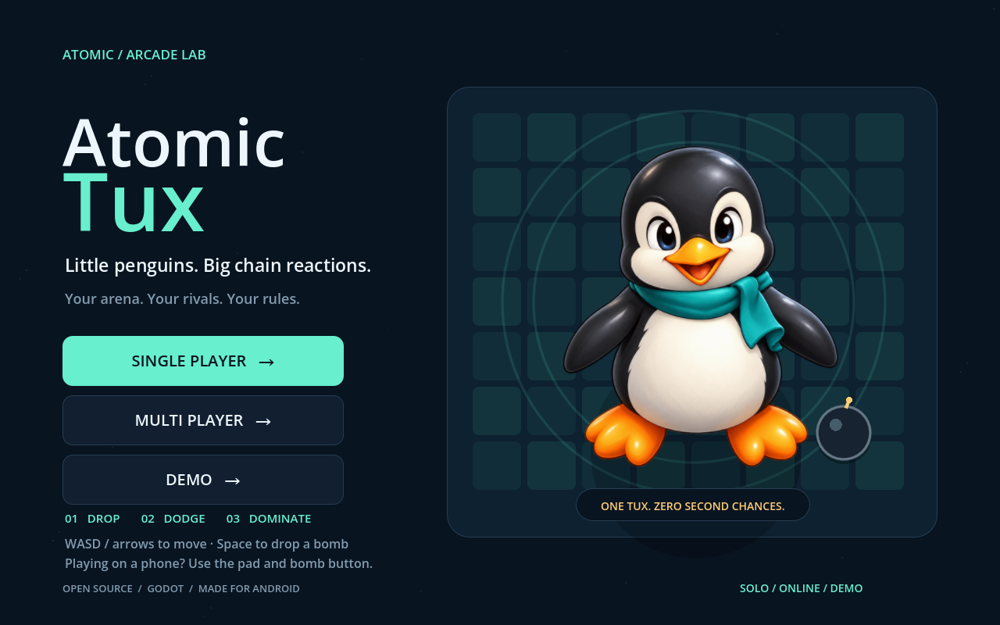
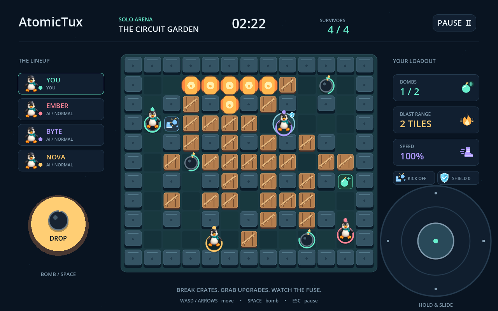
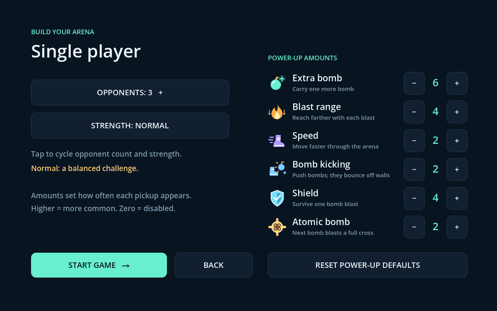

# AtomicTux

**Little penguins. Big chain reactions.**

Drop a bomb. Slip around a corner. Watch the arena change.
**AtomicTux** brings classic Bomberman-style battles to Android phones, tablets,
and desktop—with little Linux-inspired penguins, destructible crates, and
one very good reason to keep moving.

**[Install & play](docs/INSTALL.md)** · **[Host a multiplayer server](docs/MULTIPLAYER.md)** · **[Development guide](docs/DEVELOPMENT.md)**

## Small penguins. Plenty of ways to play.

- **Make it your match.** Face one to three AI opponents, choose Relaxed, Normal,
  or Fierce strength, and adjust how often each power-up appears.
- **Bring your friends.** Create or join online rooms for up to four players.
  Tune the power-up amounts, then start when you're ready; bots fill the spare seats.
  Stay for a rematch.
- **Watch the chaos.** Demo mode pits four AI penguins against each other with
  every power-up available.
- **Find a fresh route.** Every round has a connected random maze. When crates
  run low, new ones gradually return to keep the arena lively.
- **Keep your thumbs in the action.** Smooth movement, a large right-hand
  joystick, a left-hand bomb button, and a layout that adapts to phones and tablets.
- **Feel the close calls.** Nearby explosions trigger vibration on supported
  devices, backed by low rumbles and soft impact sounds.

*Break a route through the crates. Collect an advantage. Be the last Tux standing.*

## Six power-ups. One more reason to risk it.

| Power-up | Your advantage |
| --- | --- |
| **Extra bomb** | Plant more bombs at once. The most common pickup by default. |
| **Blast range** | Reach farther down the corridors. |
| **Speed** | Get a little more distance between you and the fuse. |
| **Bomb kicking** | Send bombs sliding and bouncing through the arena. |
| **Shield** | Survive one blast. Make that second chance count. |
| **Atomic bomb** | Arm your next bomb with a blast across its entire row and column—even through obstacles. |

Your own bombs are dangerous too. Ordinary blasts stop at walls and crates;
atomic blasts pass through them while permanent walls stay intact.

*Tune your next round, from a simple duel to a fully powered four-penguin battle.*

## Ready to play?

Follow the **[installation guide](docs/INSTALL.md)** to install an Android APK,
build your own, or run the game on desktop. On desktop, use **WASD / arrow keys**
to move, **Space** to plant a bomb, and **Esc** to pause.

For online play, choose **Multi Player**, enter your name, and connect to the
preconfigured default server or a server of your own. First-time
connections ask you to verify the server's certificate fingerprint.

## Open source, built with Godot

AtomicTux uses **Godot 4.6**, original game code, generated Tux-inspired artwork,
and synthesized sound effects. It is an independent project inspired by classic
bomb-arena games. Screenshots above are captured from the running desktop game.

Explore the **[development guide](docs/DEVELOPMENT.md)**, read the
**[artwork notes](docs/ART.md)**, or host your own matches with the
**[Python server](docs/MULTIPLAYER.md)**.

Released under the **[MIT license](LICENSE)**.
